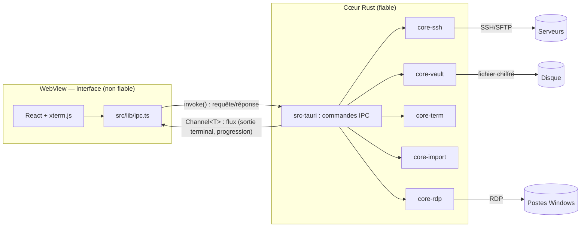
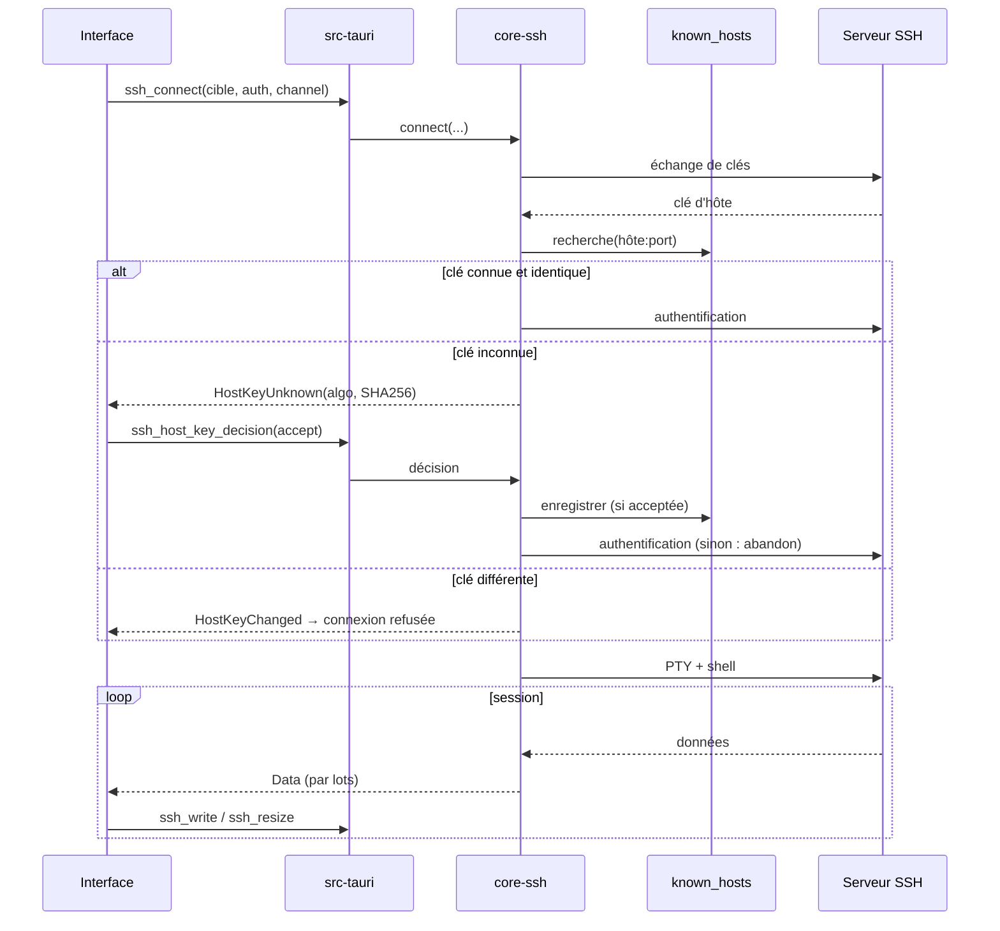

# Architecture

> Version initiale (cadrage). L'agent `docs-keeper` la met à jour à chaque étape pour qu'elle reflète le code réel.

## 1. Vue d'ensemble

Vigie est une application **Tauri 2**. Elle tourne en deux parties :
- **Le cœur Rust** (processus principal) : il détient les secrets, ouvre les connexions réseau, lit et écrit les fichiers.
- **La WebView** (WebView2 sous Windows, WebKitGTK sous Linux) : elle affiche l'interface React. Elle est considérée comme **non fiable**. Elle demande, le cœur valide et exécute.



**Frontière de confiance** : tout ce qui arrive de la WebView est validé comme une entrée externe (types, bornes, chemins). Les secrets ne repassent jamais dans la WebView.

## 2. Découpage du code

```
.
├── src/                      Interface React
│   ├── components/ui/        Composants shadcn/ui
│   ├── features/             hosts/, terminal/, sftp/, vault/, tunnels/, snippets/, settings/
│   ├── stores/               Stores zustand par domaine
│   ├── lib/ipc.ts            Seul point d'appel au backend (fonctions typées)
│   ├── lib/types.ts          Types partagés (miroir des structures Rust)
│   └── locales/{fr,en}.json  Traductions
├── src-tauri/                Application Tauri (fine)
│   ├── src/commands/         Une fonction par commande IPC
│   ├── src/state.rs          SessionManager, VaultState…
│   ├── src/error.rs          AppError { code } sérialisable
│   ├── capabilities/         Permissions par fenêtre
│   └── tauri.conf.json       Config, CSP
├── crates/
│   ├── core-ssh/             Connexion, auth, PTY distant, clés d'hôte, SFTP, tunnels
│   ├── core-vault/           Crypto du coffre, modèle de données, persistance
│   ├── core-term/            Terminal local (portable-pty / ConPTY)
│   ├── core-import/          Parseurs ~/.ssh/config et known_hosts
│   └── core-rdp/             RDP : lanceur client système (v1), IronRDP (v2)
└── Cargo.toml                Workspace
```

Dépendances entre crates : `core-ssh`, `core-term`, `core-import` et `core-rdp` ne dépendent pas de `core-vault`. C'est `src-tauri` qui récupère une identité dans le coffre et la passe à `core-ssh`. Chaque crate reste ainsi testable seule.

## 3. Communication interface ↔ cœur

| Mécanisme | Usage | Exemple |
|---|---|---|
| `invoke()` (commande) | Action ponctuelle avec un résultat | `ssh_connect`, `vault_unlock`, `sftp_list` |
| `Channel<T>` passé en argument | Flux continu, propre à une session | Sortie du terminal, progression d'un transfert, état d'un tunnel |
| Événement global | Rare, état de l'application | Coffre verrouillé automatiquement |

Exemple de commandes SSH (étape 1, indicatif) :
```
ssh_connect(target, auth, on_event: Channel<SessionEvent>) -> SessionId
ssh_write(session_id, data: bytes)
ssh_resize(session_id, cols, rows)
ssh_host_key_decision(session_id, accept: bool)
ssh_close(session_id)

SessionEvent = Data(bytes) | HostKeyUnknown { algo, sha256 } | HostKeyChanged { algo, sha256_old, sha256_new }
             | Closed { reason_code } | Error { code }
```

### Connexion SSH avec vérification de la clé d'hôte



## 4. Stockage

Dossier de données :
- **Installé** : le dossier `app_data_dir` de Tauri (`%APPDATA%\<identifier>\` sous Windows, `~/.local/share/<identifier>/` sous Linux).
- **Portable** (étape 13) : `./data/` à côté de l'exécutable si un fichier `portable.flag` y est présent.

| Fichier | Contenu | Protection |
|---|---|---|
| `vault.vigie` | Hôtes, groupes, identités, clés, snippets, tunnels | Chiffré (voir `SECURITE.md`) |
| `vault.vigie.bak` | Version précédente du coffre | Chiffré |
| `known_hosts` | Clés d'hôte acceptées (format OpenSSH) | En clair, permissions 0600. Pas de secret, mais l'intégrité compte. |
| `settings.json` | Langue, thème, police, délai de verrouillage | En clair, **aucune donnée sensible** (il doit être lisible avant le déverrouillage) |
| `logs/` | Journaux rotatifs | Aucun secret, aucun contenu de terminal |

> Point à trancher à l'étape 2 : faut-il déplacer `known_hosts` dans le coffre ? Ce serait plus confidentiel (on ne verrait plus la liste des serveurs), mais il faudrait déverrouiller pour vérifier une clé d'hôte.

## 5. Gestion des erreurs
1. Les crates renvoient des erreurs `thiserror` précises.
2. `src-tauri` les convertit en `AppError { code }`, par exemple `ssh.auth_failed`, `ssh.host_key_changed` ou `vault.wrong_password`.
3. L'interface affiche `t('errors.<code>')`. Le détail technique part dans les journaux, **sans secret**.

## 6. Interface
- Mise en page type Termius : barre latérale (Hôtes, Clés, Snippets, Tunnels, SFTP, Paramètres), zone d'onglets, panneau SFTP repliable à côté du terminal.
- Une instance xterm.js par session, gardée montée quand l'onglet est masqué.
- Stores zustand : `useSessions`, `useVault`, `useHosts`, `useSettings`…

## 7. CI/CD
- `ci.yml` (Linux, à chaque push) : fmt, clippy, tests, `cargo-deny`, lint/types/tests du front, `npm audit`, gitleaks.
- `build.yml` (manuel ou tag `v*`) : matrice `windows-latest` + `ubuntu-22.04`, `tauri-action`, installeurs en artefacts (puis en Releases après publication).
- Dependabot : cargo, npm, github-actions.
