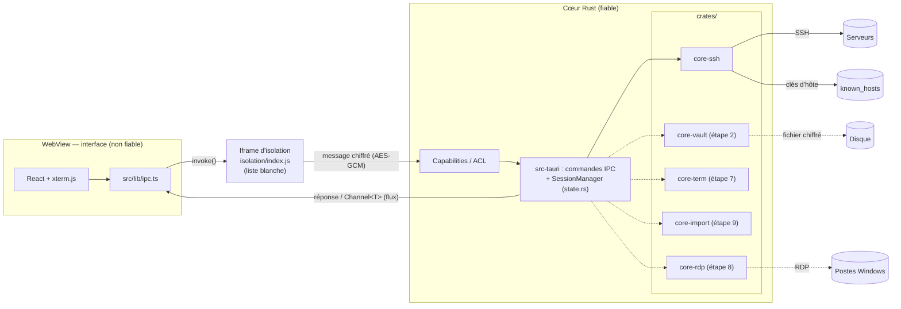
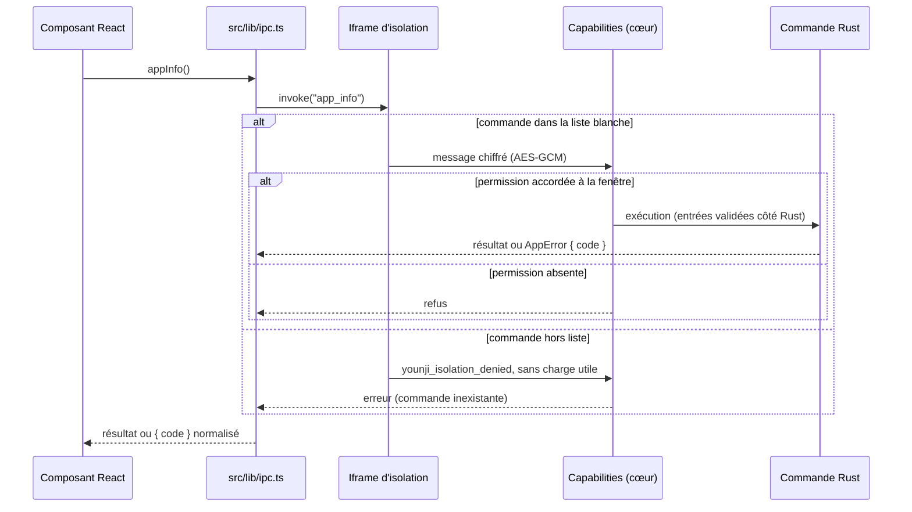
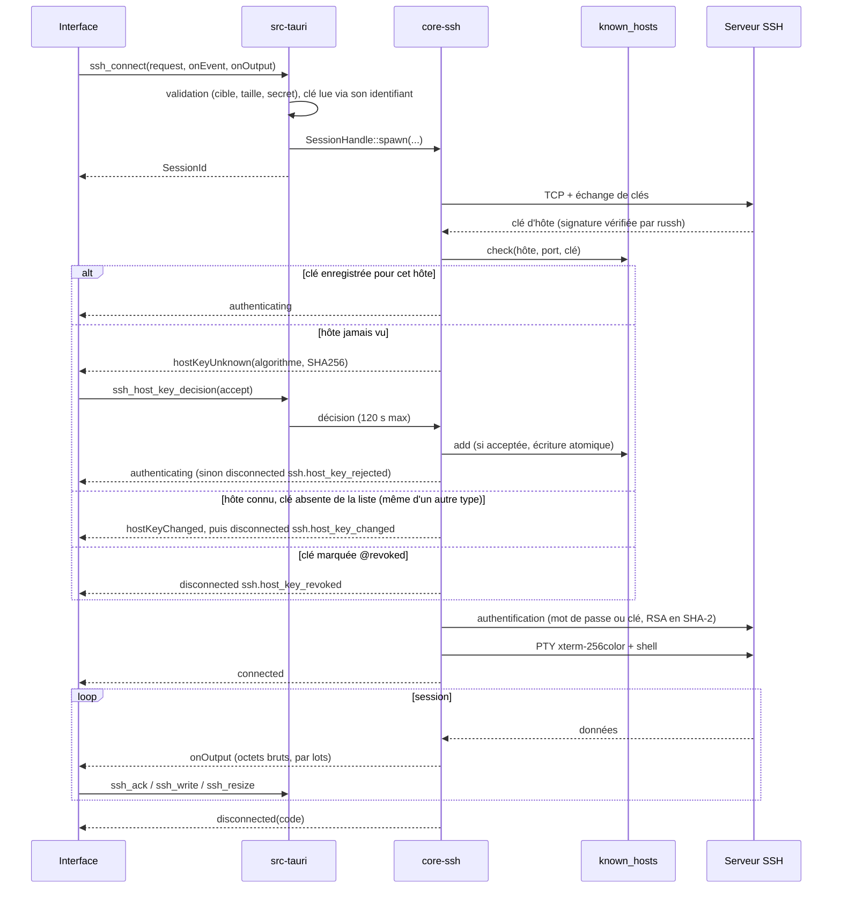

# Architecture

> Reflète le code à la fin de l'étape 1 (Terminal SSH multi-onglets). L'agent `docs-keeper` la met à jour à chaque étape. Les éléments marqués « à venir » sont prévus mais pas encore dans le code.

## 1. Vue d'ensemble

Younji est une application **Tauri 2**. Elle tourne en deux parties :
- **Le cœur Rust** (processus principal) : il détient les secrets, ouvre les connexions réseau, lit et écrit les fichiers.
- **La WebView** (WebView2 sous Windows, WebKitGTK sous Linux) : elle affiche l'interface React. Elle est considérée comme **non fiable**. Elle demande, le cœur valide et exécute.


Traits pleins : en place. Pointillés : à venir.

**Frontière de confiance** : tout ce qui arrive de la WebView est validé comme une entrée externe (types, bornes, chemins). Les secrets ne repassent jamais dans la WebView.

**Barrières, par ordre d'importance** (ADR-015) :
1. **Validation côté Rust** de chaque entrée de commande.
2. **Capabilities** : une commande n'est appelable que si une capability de la fenêtre l'accorde explicitement.
3. **Isolation** : défense en profondeur « au mieux ». Un script de la fenêtre principale peut la contourner en appelant l'IPC directement ; il se heurte alors aux capabilities. On ne compte jamais sur elle pour autoriser ou valider quoi que ce soit.

## 2. Découpage du code

État actuel (étape 1) :

```
.
├── src/                          Interface React
│   ├── components/
│   │   ├── layout/               AppShell, Sidebar, TabBar (onglets de session), SectionPlaceholder
│   │   └── ui/                   Composants de base (button, input, modal, native-select)
│   ├── features/
│   │   ├── connect/              Connexion rapide, dialogue de clé d'hôte inconnue, alerte de clé modifiée
│   │   ├── terminal/             Contrôleur xterm.js par onglet (TerminalSession), vue, recherche,
│   │   │                         menu contextuel, garde de collage, liens, file de saisie
│   │   ├── shortcuts/            Raccourcis clavier (Ctrl+Maj), blocage du rechargement hors terminal
│   │   └── settings/             Vue Paramètres (dont la liste des raccourcis), thème, préférences
│   ├── i18n/                     Initialisation i18next, détection de la langue
│   ├── locales/{fr,en}.json      Traductions (embarquées, aucun chargement réseau)
│   ├── stores/
│   │   ├── sessions.ts           Onglets de session : état, cible sans secret, clé d'hôte en attente
│   │   ├── settings.ts           Préférences langue/thème (persistées, voir §4)
│   │   └── ui.ts                 Section active de la barre latérale (non persistée)
│   ├── lib/
│   │   ├── ipc.ts                Seul point d'appel au backend (fonctions typées)
│   │   ├── types.ts              Types partagés (miroir des structures Rust)
│   │   └── utils.ts              Utilitaire de classes CSS (cn)
│   ├── test/setup.ts             Initialisation des tests Vitest
│   └── index.css                 Tailwind, thèmes, masquage de l'iframe d'isolation
├── isolation/                    Application d'isolation Tauri (index.html + index.js, sans dépendance)
├── src-tauri/                    Application Tauri (fine)
│   ├── src/
│   │   ├── main.rs               Point d'entrée
│   │   ├── lib.rs                Builder Tauri, fenêtre, plugin dialog (Rust seul), fermeture des
│   │   │                         sessions au rechargement, enregistrement des commandes
│   │   ├── state.rs              SessionManager : sessions ouvertes (64 max), fichiers de clé par identifiant
│   │   ├── commands/app.rs       Commande app_info
│   │   ├── commands/ssh.rs       Commandes ssh_* : validation, appel à core-ssh, deux Channel par session
│   │   ├── commands/url.rs       open_external_url : revalidation http(s), ouverture via la crate open
│   │   ├── error.rs              AppError { code } sérialisable, conversion depuis SshError
│   │   ├── logging.rs            Journaux rotatifs (tracing)
│   │   └── navigation.rs         Garde de navigation de la fenêtre
│   ├── build.rs                  Déclaration des commandes applicatives (AppManifest)
│   ├── capabilities/main.json    Permissions de la fenêtre principale (commandes applicatives seules)
│   ├── permissions/autogenerated/ Permissions générées par build.rs (versionnées)
│   └── tauri.conf.json           Config, CSP, isolation
├── crates/
│   └── core-ssh/                 Client SSH, sans dépendance à Tauri
│       ├── src/
│       │   ├── target.rs         Cible (hôte, port, utilisateur) et taille du terminal, validées
│       │   ├── auth.rs           Mot de passe, lecture et déchiffrement des clés privées
│       │   ├── config.rs         Algorithmes autorisés (liste explicite) et délais
│       │   ├── known_hosts.rs    Vérification et ajout des clés d'hôte (format OpenSSH)
│       │   ├── session.rs        Tâche de session : connexion, TOFU, auth, PTY, E/S, contrôle de flux
│       │   └── error.rs          SshError et ses codes stables ssh.*
│       └── tests/                local_server.rs (serveur russh en mémoire), openssh.rs (#[ignore]),
│                                 fixtures/test_host_*.pub (clés publiques uniquement)
├── tests/
│   ├── security/                 Garde-fous de configuration (CSP, capabilities, isolation)
│   └── docker/sshd/              Serveur OpenSSH jetable pour les tests d'intégration
├── scripts/
│   ├── vitest.mjs                Lanceur Vitest (normalise la lettre de lecteur sous Windows)
│   └── integration.mjs           Lanceur des tests d'intégration (charge .env.test s'il existe)
├── Cargo.toml                    Workspace (src-tauri, crates/core-ssh)
├── deny.toml                     Règles cargo-deny (avis, licences, sources)
└── rust-toolchain.toml           Toolchain stable + rustfmt + clippy
```

À venir : chaque crate rejoint le workspace à son étape : `core-vault` à l'étape 2, `core-term` à l'étape 7, `core-rdp` à l'étape 8, `core-import` à l'étape 9 ; `core-ssh` s'enrichira du SFTP (étape 4) et des tunnels (étape 6). Côté interface, `features/` accueillera `hosts/`, `sftp/`, `vault/`, `tunnels/`, `snippets/` ; `state.rs` portera aussi l'état du coffre.

### Dépendances principales ajoutées à l'étape 1
| Dépendance | Rôle | Note |
|---|---|---|
| `russh` 0.65.2 (`ring`, `rsa`) | Client SSH | Sans aws-lc-rs ni compression (ADR-019) |
| `tokio`, `tokio-util` | Tâches de session, annulation | |
| `secrecy`, `zeroize` | Secrets en mémoire | |
| `tempfile` | Écriture atomique de `known_hosts` | |
| `tauri-plugin-dialog` | Choix de la clé privée | Appelé depuis Rust seulement, aucune permission pour la WebView (ADR-020) |
| `open` | Ouverture des liens dans le navigateur | À la place de `tauri-plugin-opener` (ADR-022) |
| `@xterm/xterm` 6 + addons fit, search, web-links, unicode11, webgl | Terminal | WebGL avec repli sur le rendu DOM (ADR-018) |

Dépendances entre crates (prévues) : `core-ssh`, `core-term`, `core-import` et `core-rdp` ne dépendent pas de `core-vault`. C'est `src-tauri` qui récupère une identité dans le coffre et la passe à `core-ssh`. Chaque crate reste ainsi testable seule (ADR-004).

Règles de compilation communes (workspace) : edition 2024, `unsafe_code = "forbid"`, et `unwrap`, `expect`, `panic`, `dbg!`, `todo!` interdits par clippy hors tests.

## 3. Communication interface ↔ cœur

| Mécanisme | Usage | Exemple |
|---|---|---|
| `invoke()` (commande) | Action ponctuelle avec un résultat | `app_info`, `ssh_connect`, `ssh_write` ; plus tard `vault_unlock`, `sftp_list` |
| `Channel<T>` passé en argument | Flux continu, propre à une session | Sortie et état d'une session SSH ; plus tard progression d'un transfert, état d'un tunnel |
| Événement global | Rare, état de l'application | Coffre verrouillé automatiquement (à venir) |

Commandes existantes :

| Commande | Entrée | Sortie | Permission |
|---|---|---|---|
| `app_info` | aucune | `AppInfo { name, version }` | `allow-app-info` |
| `ssh_connect` | `request { host, port, username, auth, cols, rows }`, `onEvent: Channel<SessionEventDto>`, `onOutput: Channel<octets>` | `SessionId` (entier opaque) | `allow-ssh-connect` |
| `ssh_write` | `sessionId`, `data`, `binary` (octets 0–255 si vrai, sinon UTF-8) ; 64 Kio max | aucune | `allow-ssh-write` |
| `ssh_resize` | `sessionId`, `cols` (1–1000), `rows` (1–500) | aucune | `allow-ssh-resize` |
| `ssh_ack` | `sessionId`, `bytes` (octets affichés) | aucune | `allow-ssh-ack` |
| `ssh_host_key_decision` | `sessionId`, `accept` | aucune | `allow-ssh-host-key-decision` |
| `ssh_close` | `sessionId` | aucune | `allow-ssh-close` |
| `ssh_pick_key_file` | aucune (boîte de dialogue ouverte par le cœur) | `{ id, name } \| null` : identifiant opaque et nom du fichier, jamais le chemin | `allow-ssh-pick-key-file` |
| `open_external_url` | `url` (`http:`/`https:`, 2048 caractères max, revalidée) | aucune | `allow-open-external-url` |

`auth` vaut `{ kind: "password", password }` ou `{ kind: "key", keyFileId, passphrase | null }`. C'est le seul moment où un secret traverse l'IPC ; aucune commande n'en renvoie. Les structures Rust refusent les champs inconnus (`deny_unknown_fields`).

**Événements de session** (`SessionEventDto`, JSON sur `onEvent`, champ `type`) :

| Type | Contenu | Signification |
|---|---|---|
| `hostKeyUnknown` | `key { algorithm, fingerprint }` | Première connexion : attendre `ssh_host_key_decision` (120 s) |
| `hostKeyChanged` | `key`, `known[]`, `knownHostsPath`, `hostPattern` | Clé différente de celle enregistrée : connexion refusée. Chemin et motif de ligne servent au déblocage manuel (en attendant HKY-04) |
| `authenticating` | aucun | Clé d'hôte acceptée, authentification en cours |
| `connected` | aucun | Shell ouvert |
| `disconnected` | `code` (`ssh.*`) | Fin de session, toujours le dernier événement |

La sortie du terminal passe sur `onOutput` en **octets bruts**, par lots de 8 ms ou 32 Kio. Les messages de plus de 1 Kio sont récupérés par la commande interne `plugin:__TAURI_CHANNEL__|fetch`, que l'isolation laisse passer (ADR-024).

**Contrôle de flux** (ADR-024) : l'interface acquitte par `ssh_ack` les octets affichés par xterm.js. Au-delà de 2 Mio non acquittés, la session arrête de lire le canal SSH ; le serveur est alors freiné par la fenêtre SSH. La saisie part par une file côté interface (`inputQueue.ts`) : un seul `ssh_write` en cours, pour que les frappes ne soient jamais réordonnées.

**Cycle de vie** : chaque session vit dans une tâche tokio annulable (`SessionHandle`), enregistrée dans `SessionManager` (64 au plus). Elle se retire d'elle-même à l'événement `disconnected`. Un rechargement de la page (`PageLoadEvent::Started`) ferme toutes les sessions : les `Channel` sont perdus et plus personne ne les pilote.

### Trajet d'un appel IPC



Un appel qui contourne l'iframe (appel direct à `http://ipc.localhost/<commande>`) arrive directement aux capabilities : c'est pourquoi elles restent la barrière de référence.

### Ajouter une commande
Une commande doit être déclarée à trois endroits, sinon `tests/security/tauri-config.test.ts` échoue :
1. `src-tauri/build.rs` (`AppManifest::commands`), qui génère `allow-<commande>` ;
2. la liste blanche `ALLOWED_COMMANDS` de `isolation/index.js` ;
3. une capability (`src-tauri/capabilities/`) et la liste de permissions attendue du test.

Puis l'enregistrer dans `generate_handler!` (`lib.rs`) et l'exposer par une fonction typée dans `src/lib/ipc.ts` (types dans `src/lib/types.ts`). Les composants n'appellent jamais `invoke` directement (règle ESLint).

Les commandes internes de Tauri ont leur propre liste dans l'isolation (`INTERNAL_COMMANDS`), limitée à `plugin:__TAURI_CHANNEL__|fetch` (ADR-024). Un test vérifie qu'elle ne contient rien d'autre.

### Connexion SSH avec vérification de la clé d'hôte



Délais (`config.rs`) : connexion TCP 15 s, poignée de main 20 s, décision sur la clé d'hôte 120 s, authentification et ouverture du shell 30 s, keepalive toutes les 15 s, connexion déclarée perdue après 3 keepalives sans réponse. Les bannières du serveur sont affichées comme texte brut, nettoyées de toute séquence de contrôle (8 Kio par bannière, 64 Kio par session).

## 4. Fenêtre, stockage et journaux

### Fenêtre principale
- Créée côté Rust dans `lib.rs` (aucune fenêtre dans `tauri.conf.json`), avec le titre `APP_NAME`. Étiquette `main`, qui correspond à `capabilities/main.json`.
- **Garde de navigation** (`navigation.rs`) : seule l'origine de l'application est autorisée (`tauri://localhost`, `http(s)://tauri.localhost`), plus le serveur Vite (`http://127.0.0.1:1420`) en développement uniquement. Toute autre navigation est refusée, et l'ouverture de nouvelles fenêtres aussi. Seul le schéma de l'adresse refusée est journalisé.

### Dossier de données
- **Installé** : le dossier `app_data_dir` de Tauri (`%APPDATA%\<identifier>\` sous Windows, `~/.local/share/<identifier>/` sous Linux).
- **Portable** (étape 13) : `./data/` à côté de l'exécutable si un fichier `portable.flag` y est présent.

| Fichier | Contenu | Protection | Disponible |
|---|---|---|---|
| `vault.younji` | Hôtes, groupes, identités, clés, snippets, tunnels | Chiffré (voir `SECURITE.md`) | Étape 2 |
| `vault.younji.bak` | Version précédente du coffre | Chiffré | Étape 2 |
| `known_hosts` | Clés d'hôte acceptées (format OpenSSH, noms non hachés) | En clair, écriture atomique, permissions 0600 (dossier 0700) sous Linux. Pas de secret, mais l'intégrité compte. Lecture limitée à 4 Mio. | Oui (étape 1) |
| `settings.json` | Langue, thème, police, délai de verrouillage | En clair, **aucune donnée sensible** (il doit être lisible avant le déverrouillage) | Étape 2 |

> Point à trancher à l'étape 2 : faut-il déplacer `known_hosts` dans le coffre ? Ce serait plus confidentiel (on ne verrait plus la liste des serveurs), mais il faudrait déverrouiller pour vérifier une clé d'hôte (ADR-006, ADR-023). En attendant la gestion dans l'interface (HKY-04), une clé d'hôte se supprime à la main dans ce fichier ; l'alerte de clé modifiée indique le chemin et la ligne à retirer.

**Fichiers de clé privée** : jamais copiés ni stockés. Leur chemin reste en mémoire dans `SessionManager` pendant l'exécution, derrière un identifiant opaque (ADR-020).

**Préférences (provisoire)** : jusqu'à l'étape 2, la langue et le thème sont stockés dans le `localStorage` de la WebView (clé `younji.settings`). Les valeurs relues sont validées et toute valeur inattendue est ignorée. Elles migreront vers `settings.json`, géré par le backend.

### Journaux
- Dossier `app_log_dir` de Tauri (`%LOCALAPPDATA%\<identifier>\logs\` sous Windows, `~/.local/share/<identifier>/logs/` sous Linux), créé en 0700 sous Linux.
- Fichiers `younji.<date>.log`, rotation quotidienne, 7 fichiers au plus. En développement, les journaux sont aussi affichés sur la console. Si le dossier est inutilisable, repli sur la console (jamais sur un dossier temporaire partagé).
- `YOUNJI_LOG` (`error` à `trace`, `info` par défaut) ne règle que le niveau du **code de Younji** : cibles `younji`, `younji_lib` et `core_ssh` (chaque nouvelle crate `core_*` s'ajoute à `OWN_TARGETS` dans `logging.rs`). Les dépendances, dont `russh`, restent plafonnées à `warn`, pour qu'un niveau élevé ne fasse jamais journaliser des paquets réseau ou des arguments IPC.
- `core_ssh` journalise la cible (`utilisateur@hôte:port`) et la cause de fin de session au niveau `debug`, un changement de clé d'hôte au niveau `warn`.
- Aucun secret, aucun contenu de terminal ni de fichier transféré (`SECURITE.md` §6).

## 5. Gestion des erreurs
1. Les crates renvoient des erreurs `thiserror` précises. `SshError` (`core-ssh`) ne transporte aucune donnée : ni secret, ni entrée utilisateur, ni texte du serveur.
2. `src-tauri` les convertit en `AppError { code }`, par exemple `ssh.auth_failed`, `ssh.host_key_changed` ou `ssh.connection_lost`. Il ajoute ses propres codes (`ssh.session_not_found`, `ssh.too_many_sessions`, `ssh.key_file_unknown`, `dialog.failed`, `url.invalid`, `url.open_failed`, `internal`). Seul le code est sérialisé. Un test Rust vérifie que chaque code a sa traduction FR et EN.
3. `src/lib/ipc.ts` normalise toute erreur reçue en `{ code }` ; un message brut n'est jamais propagé, et une erreur de forme inattendue devient `unknown`.
4. L'interface affiche `t('errors.<code>')`. Le détail technique part dans les journaux, **sans secret**.

## 6. Interface
- Mise en page type Termius : barre latérale (Hôtes, Clés, Snippets, Tunnels, SFTP, Paramètres) et zone d'onglets. Le premier onglet (accueil) affiche la section choisie dans la barre latérale ; les sections autres que Paramètres affichent un emplacement réservé.
- **Onglets de session** (`stores/sessions.ts`, `TabBar`) : ouvrir, fermer, renommer (double-clic ou F2), réordonner (glisser ou raccourci). États : `form` → `connecting` → `hostKey` → `authenticating` → `connected` → `disconnected`, ou `blocked` si la clé d'hôte a changé. Le store ne contient **aucun secret** : la cible mémorisée sert à pré-remplir le formulaire de reconnexion, qui redemande le mot de passe ou la passphrase (ADR-021).
- **Terminal** (`features/terminal/`) : un contrôleur `TerminalSession` par onglet, hors de React, qui garde l'instance xterm.js, son tampon (10 000 lignes) et sa session quand l'onglet est masqué. Addons fit (avec `ResizeObserver` et anti-rebond de 100 ms vers `ssh_resize`), search, web-links, unicode11 et WebGL (repli sur le rendu DOM si WebGL est indisponible).
- **Protections du terminal** : pas d'addon presse-papiers, donc les séquences OSC 52 restent sans effet ; garde de collage (`paste.ts`) qui retire les marqueurs de « bracketed paste » et demande confirmation, avec aperçu, pour un texte multiligne ou contenant des caractères de contrôle ; liens `http(s)` ouverts au Ctrl+clic, avec confirmation de l'adresse réelle pour les liens OSC 8 (`links.ts`, ADR-022).
- **Raccourcis** (`features/shortcuts/`) : tous en Ctrl+Maj (ou Ctrl+Tab, Ctrl+PgPréc/PgSuiv) pour laisser au shell ses propres raccourcis ; liste affichée dans les Paramètres. Hors du terminal, F5 et Ctrl+R sont bloqués, car un rechargement fermerait toutes les sessions.
- **Paramètres** : langue (système, français, anglais) et thème (système, clair, sombre), appliqués à chaud ; raccourcis clavier ; affichage du nom et de la version via `app_info`.
- **Langue** : en mode « système », détectée depuis `navigator.languages` (première langue prise en charge), repli sur l'anglais. Fixée avant le premier rendu pour éviter un affichage dans la mauvaise langue.
- **Thème** : en mode « système », suit `prefers-color-scheme` à chaud ; classe `light` / `dark` sur `<html>`.
- Stores zustand : `useSettings`, `useUi` et `useSessions` ; `useVault`, `useHosts`… à venir.
- À venir : panneau SFTP repliable à côté du terminal (étape 4), écran partagé (étape 5).

## 7. Outillage et CI/CD

### Vérifications locales
`npm run check` enchaîne ESLint, Prettier, `tsc -b`, Vitest (via `scripts/vitest.mjs`), `cargo fmt --check`, `cargo clippy -D warnings` et `cargo test`. `npm run audit` lance `cargo deny check` et `npm audit --omit=dev --audit-level=high`.

### Tests SSH
- **Sans serveur externe** (`cargo test`) : `crates/core-ssh/tests/local_server.rs` lance un serveur russh en mémoire sur 127.0.0.1 et vérifie le TOFU, le blocage d'une clé modifiée (y compris d'un autre type), l'authentification et le contrôle de flux. Toutes les clés sont générées à l'exécution.
- **Contre OpenSSH** (`npm run test:integration`) : `crates/core-ssh/tests/openssh.rs`, tests `#[ignore]`. `scripts/integration.mjs` charge `.env.test` s'il existe puis lance `cargo test --workspace -- --ignored`. La cible est lue dans les variables `YOUNJI_TEST_*` (`ENVIRONNEMENT_DE_TEST.md` §6) ; un test dont la variable manque est ignoré, sauf si `YOUNJI_TEST_REQUIRED=1`.
- **Serveur de test** : `tests/docker/sshd/` (Debian 12 épinglée par empreinte, OpenSSH). Aucun secret dans l'image : le mot de passe arrive par un fichier d'environnement, les clés autorisées par un volume en lecture seule, et les clés d'hôte sont régénérées à chaque démarrage.

### `ci.yml` (Linux, à chaque push et PR)
Permissions en lecture seule, actions épinglées par SHA, `persist-credentials: false`. Cinq jobs :

| Job | Contenu |
|---|---|
| Interface | `npm ci --ignore-scripts`, lint, types, tests ; `npm audit --omit=dev --audit-level=high` **bloquant** ; audit npm complet affiché sans bloquer (exception documentée dans `SECURITE.md` §8) |
| Rust | Dépendances WebKitGTK, `cargo fmt --check`, `cargo clippy --locked -D warnings`, `cargo test --locked` |
| Intégration SSH | Génère à chaque exécution un mot de passe et des clés de test (Ed25519 avec passphrase, ECDSA, RSA), masqués dans les journaux ; démarre le conteneur `tests/docker/sshd` sur 127.0.0.1:2222 ; lance `cargo test -p core-ssh -- --ignored` avec `YOUNJI_TEST_REQUIRED=1`. Aucun secret GitHub. |
| cargo-deny | Avis RustSec, licences compatibles GPL-3.0, sources (`deny.toml`) |
| gitleaks | Binaire épinglé et vérifié par SHA-256, analyse de tout l'historique |

### `build.yml` (manuel ou tag `v*`)
Matrice `windows-latest` (NSIS + MSI) et `ubuntu-22.04` (deb + AppImage). `npm ci --ignore-scripts`, puis compilation directe par la CLI Tauri (`npx tauri build --ci --bundles … -- --locked`) : pas d'action tierce supplémentaire, aucun secret. Installeurs publiés en artefacts du workflow (14 jours), pas de release tant que le dépôt est privé.

### Dependabot
Hebdomadaire pour cargo, npm et github-actions, mises à jour mineures groupées, **délai de 7 jours** (`cooldown`) avant d'adopter une nouvelle version, pour laisser le temps de détecter une publication compromise.
