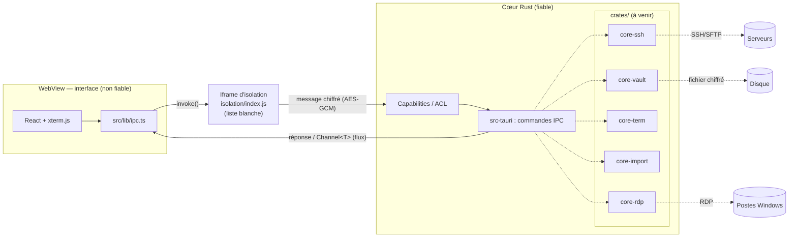
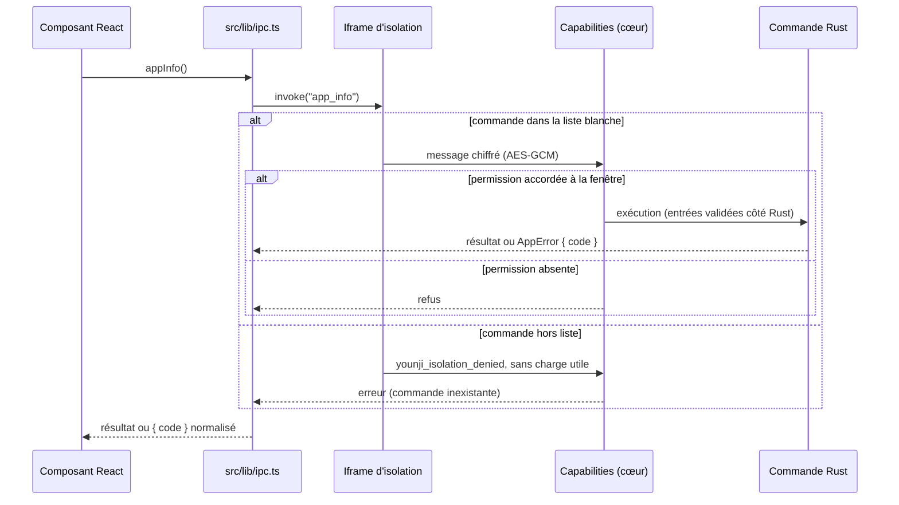
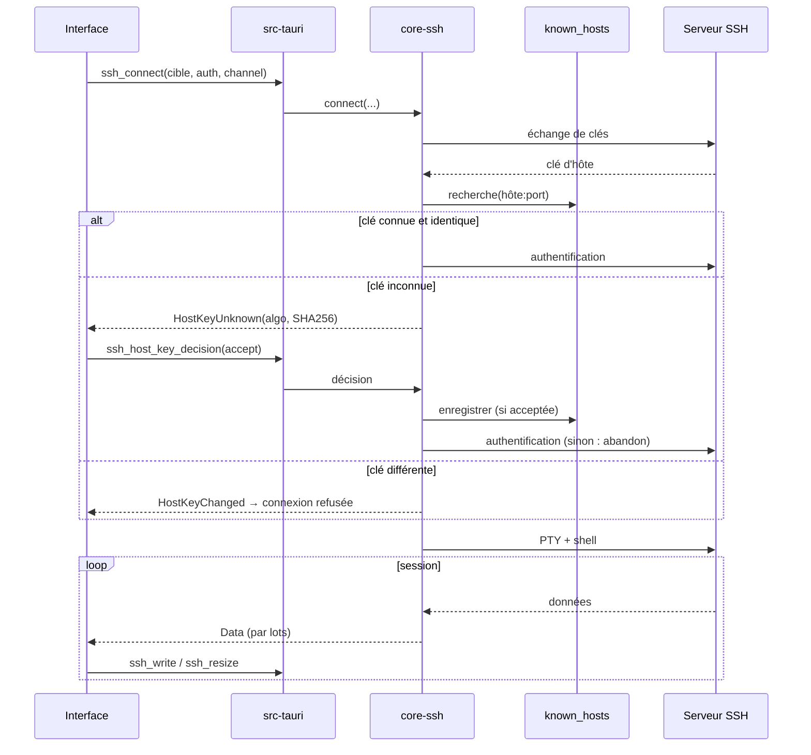

# Architecture

> Reflète le code à la fin de l'étape 0 (Fondations). L'agent `docs-keeper` la met à jour à chaque étape. Les éléments marqués « à venir » sont prévus mais pas encore dans le code.

## 1. Vue d'ensemble

Younji est une application **Tauri 2**. Elle tourne en deux parties :
- **Le cœur Rust** (processus principal) : il détient les secrets, ouvre les connexions réseau, lit et écrit les fichiers.
- **La WebView** (WebView2 sous Windows, WebKitGTK sous Linux) : elle affiche l'interface React. Elle est considérée comme **non fiable**. Elle demande, le cœur valide et exécute.



**Frontière de confiance** : tout ce qui arrive de la WebView est validé comme une entrée externe (types, bornes, chemins). Les secrets ne repassent jamais dans la WebView.

**Barrières, par ordre d'importance** (ADR-015) :
1. **Validation côté Rust** de chaque entrée de commande.
2. **Capabilities** : une commande n'est appelable que si une capability de la fenêtre l'accorde explicitement.
3. **Isolation** : défense en profondeur « au mieux ». Un script de la fenêtre principale peut la contourner en appelant l'IPC directement ; il se heurte alors aux capabilities. On ne compte jamais sur elle pour autoriser ou valider quoi que ce soit.

## 2. Découpage du code

État actuel (étape 0) :

```
.
├── src/                          Interface React
│   ├── components/
│   │   ├── layout/               AppShell, Sidebar, TabBar, SectionPlaceholder
│   │   └── ui/                   Composants shadcn/ui (button, native-select)
│   ├── features/settings/        Vue Paramètres, thème, application des préférences
│   ├── i18n/                     Initialisation i18next, détection de la langue
│   ├── locales/{fr,en}.json      Traductions (embarquées, aucun chargement réseau)
│   ├── stores/
│   │   ├── settings.ts           Préférences langue/thème (persistées, voir §4)
│   │   └── ui.ts                 Section active de la barre latérale (non persistée)
│   ├── lib/
│   │   ├── ipc.ts                Seul point d'appel au backend (fonctions typées)
│   │   ├── types.ts              Types partagés (miroir des structures Rust)
│   │   └── utils.ts              Utilitaire de classes CSS (cn)
│   ├── test/setup.ts             Initialisation des tests Vitest
│   └── index.css                 Tailwind, thèmes, masquage de l'iframe d'isolation
├── isolation/                    Application d'isolation Tauri (index.html + index.js, sans dépendance)
├── src-tauri/                    Application Tauri (fine)
│   ├── src/
│   │   ├── main.rs               Point d'entrée
│   │   ├── lib.rs                Builder Tauri, création de la fenêtre, enregistrement des commandes
│   │   ├── commands/app.rs       Commande app_info
│   │   ├── error.rs              AppError { code } sérialisable
│   │   ├── logging.rs            Journaux rotatifs (tracing)
│   │   └── navigation.rs         Garde de navigation de la fenêtre
│   ├── build.rs                  Déclaration des commandes applicatives (AppManifest)
│   ├── capabilities/main.json    Permissions de la fenêtre principale
│   ├── permissions/autogenerated/ Permissions générées par build.rs (versionnées)
│   └── tauri.conf.json           Config, CSP, isolation
├── tests/security/               Garde-fous de configuration (CSP, capabilities, isolation)
├── scripts/vitest.mjs            Lanceur Vitest (normalise la lettre de lecteur sous Windows)
├── Cargo.toml                    Workspace (membre unique : src-tauri)
├── deny.toml                     Règles cargo-deny (avis, licences, sources)
└── rust-toolchain.toml           Toolchain stable + rustfmt + clippy
```

À venir : `crates/` n'existe pas encore. Chaque crate rejoint le workspace à son étape : `core-ssh` à l'étape 1 (connexion, auth, PTY distant, clés d'hôte, puis SFTP et tunnels), `core-vault` à l'étape 2, `core-term` à l'étape 7, `core-rdp` à l'étape 8, `core-import` à l'étape 9. Côté interface, `features/` accueillera `hosts/`, `terminal/`, `sftp/`, `vault/`, `tunnels/`, `snippets/` ; côté Rust, `src-tauri/src/state.rs` portera l'état des sessions et du coffre.

Dépendances entre crates (prévues) : `core-ssh`, `core-term`, `core-import` et `core-rdp` ne dépendent pas de `core-vault`. C'est `src-tauri` qui récupère une identité dans le coffre et la passe à `core-ssh`. Chaque crate reste ainsi testable seule (ADR-004).

Règles de compilation communes (workspace) : edition 2024, `unsafe_code = "forbid"`, et `unwrap`, `expect`, `panic`, `dbg!`, `todo!` interdits par clippy hors tests.

## 3. Communication interface ↔ cœur

| Mécanisme | Usage | Exemple |
|---|---|---|
| `invoke()` (commande) | Action ponctuelle avec un résultat | `app_info` ; plus tard `ssh_connect`, `vault_unlock`, `sftp_list` |
| `Channel<T>` passé en argument | Flux continu, propre à une session | Sortie du terminal, progression d'un transfert, état d'un tunnel (à venir) |
| Événement global | Rare, état de l'application | Coffre verrouillé automatiquement (à venir) |

Commandes existantes :

| Commande | Entrée | Sortie | Permission |
|---|---|---|---|
| `app_info` | aucune | `AppInfo { name, version }` | `allow-app-info` |

### Trajet d'un appel IPC



Un appel qui contourne l'iframe (appel direct à `http://ipc.localhost/<commande>`) arrive directement aux capabilities : c'est pourquoi elles restent la barrière de référence.

### Ajouter une commande
Une commande doit être déclarée à trois endroits, sinon `tests/security/tauri-config.test.ts` échoue :
1. `src-tauri/build.rs` (`AppManifest::commands`), qui génère `allow-<commande>` ;
2. la liste blanche `ALLOWED_COMMANDS` de `isolation/index.js` ;
3. une capability (`src-tauri/capabilities/`) et la liste de permissions attendue du test.

Puis l'enregistrer dans `generate_handler!` (`lib.rs`) et l'exposer par une fonction typée dans `src/lib/ipc.ts` (types dans `src/lib/types.ts`). Les composants n'appellent jamais `invoke` directement (règle ESLint).

### Commandes SSH prévues (étape 1, indicatif)
```
ssh_connect(target, auth, on_event: Channel<SessionEvent>) -> SessionId
ssh_write(session_id, data: bytes)
ssh_resize(session_id, cols, rows)
ssh_host_key_decision(session_id, accept: bool)
ssh_close(session_id)

SessionEvent = Data(bytes) | HostKeyUnknown { algo, sha256 } | HostKeyChanged { algo, sha256_old, sha256_new }
             | Closed { reason_code } | Error { code }
```

### Connexion SSH avec vérification de la clé d'hôte (étape 1)



## 4. Fenêtre, stockage et journaux

### Fenêtre principale
- Créée côté Rust dans `lib.rs` (aucune fenêtre dans `tauri.conf.json`), avec le titre `APP_NAME`. Étiquette `main`, qui correspond à `capabilities/main.json`.
- **Garde de navigation** (`navigation.rs`) : seule l'origine de l'application est autorisée (`tauri://localhost`, `http(s)://tauri.localhost`), plus le serveur Vite (`http://127.0.0.1:1420`) en développement uniquement. Toute autre navigation est refusée, et l'ouverture de nouvelles fenêtres aussi. Seul le schéma de l'adresse refusée est journalisé.

### Dossier de données
- **Installé** : le dossier `app_data_dir` de Tauri (`%APPDATA%\<identifier>\` sous Windows, `~/.local/share/<identifier>/` sous Linux).
- **Portable** (étape 13) : `./data/` à côté de l'exécutable si un fichier `portable.flag` y est présent.

| Fichier | Contenu | Protection | Disponible |
|---|---|---|---|
| `vault.younji` | Hôtes, groupes, identités, clés, snippets, tunnels | Chiffré (voir `SECURITE.md`) | Étape 2 |
| `vault.younji.bak` | Version précédente du coffre | Chiffré | Étape 2 |
| `known_hosts` | Clés d'hôte acceptées (format OpenSSH) | En clair, permissions 0600. Pas de secret, mais l'intégrité compte. | Étape 1 |
| `settings.json` | Langue, thème, police, délai de verrouillage | En clair, **aucune donnée sensible** (il doit être lisible avant le déverrouillage) | Étape 2 |

> Point à trancher à l'étape 2 : faut-il déplacer `known_hosts` dans le coffre ? Ce serait plus confidentiel (on ne verrait plus la liste des serveurs), mais il faudrait déverrouiller pour vérifier une clé d'hôte.

**Préférences (provisoire)** : jusqu'à l'étape 2, la langue et le thème sont stockés dans le `localStorage` de la WebView (clé `younji.settings`). Les valeurs relues sont validées et toute valeur inattendue est ignorée. Elles migreront vers `settings.json`, géré par le backend.

### Journaux
- Dossier `app_log_dir` de Tauri (`%LOCALAPPDATA%\<identifier>\logs\` sous Windows, `~/.local/share/<identifier>/logs/` sous Linux), créé en 0700 sous Linux.
- Fichiers `younji.<date>.log`, rotation quotidienne, 7 fichiers au plus. En développement, les journaux sont aussi affichés sur la console. Si le dossier est inutilisable, repli sur la console (jamais sur un dossier temporaire partagé).
- `YOUNJI_LOG` (`error` à `trace`, `info` par défaut) ne règle que le niveau du **code de Younji**. Les dépendances restent plafonnées à `warn`, pour qu'un niveau élevé ne fasse jamais journaliser des paquets réseau ou des arguments IPC.
- Aucun secret, aucun contenu de terminal ni de fichier transféré (`SECURITE.md` §6).

## 5. Gestion des erreurs
1. Les crates renvoient des erreurs `thiserror` précises.
2. `src-tauri` les convertit en `AppError { code }`, par exemple `ssh.auth_failed`, `ssh.host_key_changed` ou `vault.wrong_password`. Seul le code est sérialisé.
3. `src/lib/ipc.ts` normalise toute erreur reçue en `{ code }` ; un message brut n'est jamais propagé, et une erreur de forme inattendue devient `unknown`.
4. L'interface affiche `t('errors.<code>')`. Le détail technique part dans les journaux, **sans secret**.

## 6. Interface
- Mise en page type Termius : barre latérale (Hôtes, Clés, Snippets, Tunnels, SFTP, Paramètres), zone d'onglets (onglet d'accueil seul à l'étape 0). Les sections autres que Paramètres affichent un emplacement réservé.
- **Paramètres** : langue (système, français, anglais) et thème (système, clair, sombre), appliqués à chaud ; affichage du nom et de la version via `app_info`.
- **Langue** : en mode « système », détectée depuis `navigator.languages` (première langue prise en charge), repli sur l'anglais. Fixée avant le premier rendu pour éviter un affichage dans la mauvaise langue.
- **Thème** : en mode « système », suit `prefers-color-scheme` à chaud ; classe `light` / `dark` sur `<html>`.
- Stores zustand : `useSettings` et `useUi` aujourd'hui ; `useSessions`, `useVault`, `useHosts`… à venir.
- À venir (étape 1) : une instance xterm.js par session, gardée montée quand l'onglet est masqué ; panneau SFTP repliable à côté du terminal (étape 4).

## 7. Outillage et CI/CD

### Vérifications locales
`npm run check` enchaîne ESLint, Prettier, `tsc -b`, Vitest (via `scripts/vitest.mjs`), `cargo fmt --check`, `cargo clippy -D warnings` et `cargo test`. `npm run audit` lance `cargo deny check` et `npm audit --omit=dev --audit-level=high`.

### `ci.yml` (Linux, à chaque push et PR)
Permissions en lecture seule, actions épinglées par SHA, `persist-credentials: false`. Quatre jobs :

| Job | Contenu |
|---|---|
| Interface | `npm ci --ignore-scripts`, lint, types, tests ; `npm audit --omit=dev --audit-level=high` **bloquant** ; audit npm complet affiché sans bloquer (exception documentée dans `SECURITE.md` §8) |
| Rust | Dépendances WebKitGTK, `cargo fmt --check`, `cargo clippy --locked -D warnings`, `cargo test --locked` |
| cargo-deny | Avis RustSec, licences compatibles GPL-3.0, sources (`deny.toml`) |
| gitleaks | Binaire épinglé et vérifié par SHA-256, analyse de tout l'historique |

### `build.yml` (manuel ou tag `v*`)
Matrice `windows-latest` (NSIS + MSI) et `ubuntu-22.04` (deb + AppImage). `npm ci --ignore-scripts`, puis compilation directe par la CLI Tauri (`npx tauri build --ci --bundles … -- --locked`) : pas d'action tierce supplémentaire, aucun secret. Installeurs publiés en artefacts du workflow (14 jours), pas de release tant que le dépôt est privé.

### Dependabot
Hebdomadaire pour cargo, npm et github-actions, mises à jour mineures groupées, **délai de 7 jours** (`cooldown`) avant d'adopter une nouvelle version, pour laisser le temps de détecter une publication compromise.
