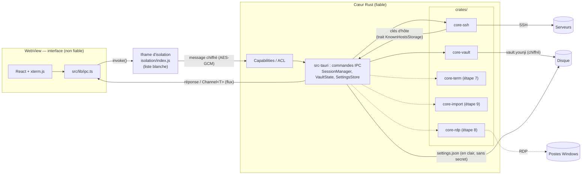
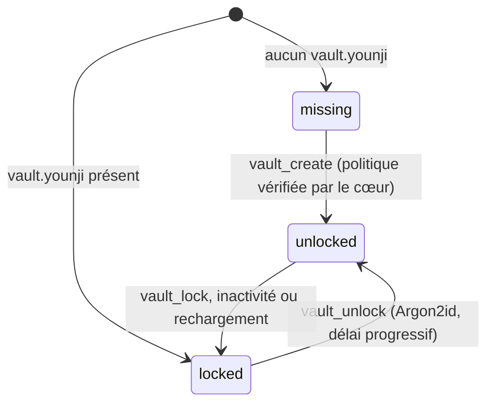
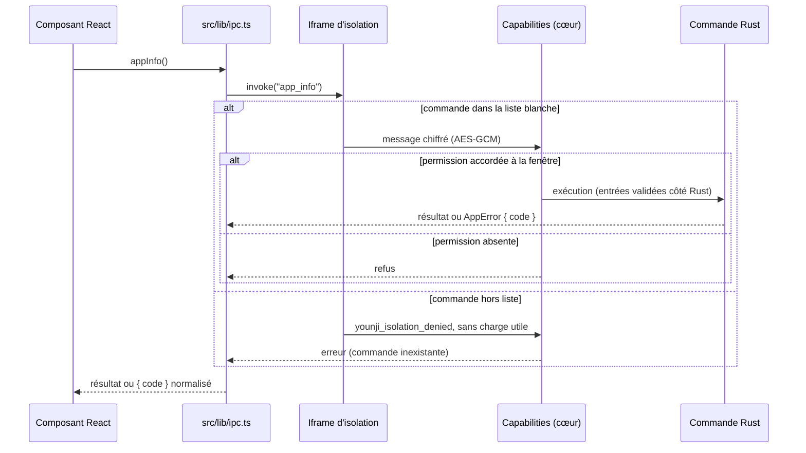
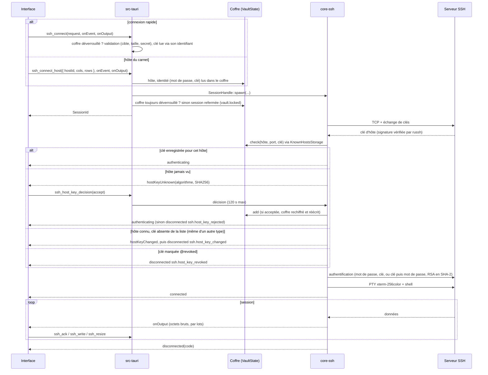

# Architecture

> Reflète le code à la fin de l'étape 2 (Coffre chiffré et carnet d'hôtes). L'agent `docs-keeper` la met à jour à chaque étape. Les éléments marqués « à venir » sont prévus mais pas encore dans le code.

## 1. Vue d'ensemble

Younji est une application **Tauri 2**. Elle tourne en deux parties :
- **Le cœur Rust** (processus principal) : il détient les secrets, ouvre les connexions réseau, lit et écrit les fichiers.
- **La WebView** (WebView2 sous Windows, WebKitGTK sous Linux) : elle affiche l'interface React. Elle est considérée comme **non fiable**. Elle demande, le cœur valide et exécute.


Traits pleins : en place. Pointillés : à venir.

**Frontière de confiance** : tout ce qui arrive de la WebView est validé comme une entrée externe (types, bornes, chemins, identifiants). Les secrets ne repassent jamais dans la WebView.

**Barrières, par ordre d'importance** (ADR-015) :
1. **Validation côté Rust** de chaque entrée de commande.
2. **Capabilities** : une commande n'est appelable que si une capability de la fenêtre l'accorde explicitement.
3. **Isolation** : défense en profondeur « au mieux ». Un script de la fenêtre principale peut la contourner en appelant l'IPC directement ; il se heurte alors aux capabilities. On ne compte jamais sur elle pour autoriser ou valider quoi que ce soit.

## 2. Découpage du code

État actuel (étape 2) :

```
.
├── src/                          Interface React
│   ├── components/
│   │   ├── layout/               AppShell, Sidebar (avec bouton « Verrouiller »), TabBar, SectionPlaceholder
│   │   ├── ui/                   Composants de base (button, avec variante destructive ; input, modal, native-select)
│   │   ├── ConfirmDialog.tsx     Confirmation générique (bouton rouge pour une action destructrice)
│   │   └── NameDialog.tsx        Saisie d'un nom (groupe, clé), longueur bornée comme dans le cœur
│   ├── features/
│   │   ├── vault/                Porte du coffre (VaultGate), création avec indicateur de robustesse,
│   │   │                         déverrouillage, verrouillage (lock.ts), lien avec le minuteur du cœur
│   │   │                         (useVaultSession), estimation zxcvbn-ts chargée à la demande (strength.ts)
│   │   ├── hosts/                Carnet d'hôtes : liste par groupe, recherche (filter.ts), formulaire,
│   │   │                         ouverture d'une session depuis le carnet (openHost.ts)
│   │   ├── keys/                 Clés importées, identités, clés d'hôte connues (HKY-04)
│   │   ├── connect/              Connexion rapide, dialogue de clé d'hôte inconnue, alerte de clé modifiée
│   │   ├── terminal/             Contrôleur xterm.js par onglet (TerminalSession), vue, recherche,
│   │   │                         menu contextuel, garde de collage, liens, file de saisie
│   │   ├── shortcuts/            Raccourcis clavier (Ctrl+Maj), blocage du rechargement hors terminal
│   │   └── settings/             Paramètres (apparence, police, sécurité, raccourcis), changement
│   │                             du mot de passe maître
│   ├── i18n/                     Initialisation i18next, détection de la langue
│   ├── locales/{fr,en}.json      Traductions (embarquées, aucun chargement réseau)
│   ├── stores/
│   │   ├── vault.ts              État du coffre et contenu affichable (sans secret), vidé au verrouillage
│   │   ├── sessions.ts           Onglets de session : état, cible sans secret, clé d'hôte en attente
│   │   ├── settings.ts           Préférences (langue, thème, police), persistées par le cœur (voir §4)
│   │   └── ui.ts                 Section active de la barre latérale (non persistée)
│   ├── lib/
│   │   ├── ipc.ts                Seul point d'appel au backend (fonctions typées)
│   │   ├── types.ts              Types partagés (miroir des structures Rust)
│   │   └── utils.ts              Utilitaire de classes CSS (cn)
│   ├── test/setup.ts             Initialisation des tests Vitest
│   └── index.css                 Tailwind, thèmes, masquage de l'iframe d'isolation
├── isolation/                    Application d'isolation Tauri (index.html + index.js, sans dépendance)
├── src-tauri/                    Application Tauri (fine)
│   ├── src/
│   │   ├── main.rs               Point d'entrée
│   │   ├── lib.rs                Builder Tauri, fenêtre, plugin dialog (Rust seul), minuteur de
│   │   │                         verrouillage, verrouillage au rechargement, enregistrement des commandes
│   │   ├── state.rs              SessionManager : sessions ouvertes (64 max), fichiers de clé par identifiant
│   │   ├── vault_state.rs        VaultState : coffre verrouillé ou non, tentatives et délai progressif,
│   │   │                         activité (double horloge), Channel de vault_watch ; VaultKnownHosts
│   │   ├── settings.rs           SettingsStore : settings.json validé, écriture atomique
│   │   ├── commands/app.rs       Commande app_info
│   │   ├── commands/ssh.rs       Commandes ssh_* : validation, appel à core-ssh, deux Channel par session ;
│   │   │                         ssh_connect_host (identité lue dans le coffre)
│   │   ├── commands/vault.rs     Commandes vault_* (cycle de vie du coffre) et lock_everything
│   │   ├── commands/book.rs      Carnet : vault_snapshot, host_*, group_*, identity_*, key_*, known_host_*
│   │   ├── commands/settings.rs  settings_get, settings_set
│   │   ├── commands/url.rs       open_external_url : revalidation http(s), ouverture via la crate open
│   │   ├── error.rs              AppError { code } sérialisable, conversion depuis SshError et VaultError
│   │   ├── logging.rs            Journaux rotatifs (tracing)
│   │   └── navigation.rs         Garde de navigation de la fenêtre
│   ├── build.rs                  Déclaration des commandes applicatives (AppManifest)
│   ├── capabilities/main.json    Permissions de la fenêtre principale (commandes applicatives seules)
│   ├── permissions/autogenerated/ Permissions générées par build.rs (versionnées)
│   └── tauri.conf.json           Config, CSP, isolation
├── crates/
│   ├── core-ssh/                 Client SSH, sans dépendance à Tauri ni à core-vault
│   │   ├── src/
│   │   │   ├── target.rs         Cible (hôte, port, utilisateur) et taille du terminal, validées
│   │   │   ├── auth.rs           Mot de passe, clés privées ; import (ré-encodage sans passphrase),
│   │   │   │                     identité « clé puis mot de passe »
│   │   │   ├── config.rs         Algorithmes autorisés (liste explicite) et délais
│   │   │   ├── known_hosts.rs    Vérification, ajout, liste et suppression des clés d'hôte (format
│   │   │   │                     OpenSSH), stockage abstrait (trait KnownHostsStorage, FileStorage)
│   │   │   ├── session.rs        Tâche de session : connexion, TOFU, auth, PTY, E/S, contrôle de flux
│   │   │   └── error.rs          SshError et ses codes stables ssh.*
│   │   └── tests/                local_server.rs (serveur russh en mémoire), openssh.rs (#[ignore]),
│   │                             fixtures/test_host_*.pub (clés publiques uniquement)
│   └── core-vault/               Coffre chiffré, sans dépendance à Tauri ni à core-ssh
│       └── src/
│           ├── format.rs         Format de fichier v1 (en-tête, bornes, lecture sans allocation excessive)
│           ├── crypto.rs         Argon2id → KEK, enveloppe de la DEK, XChaCha20-Poly1305, aléa du système
│           ├── store.rs          Vault : création, déverrouillage, sauvegarde atomique + .bak,
│           │                     changement de mot de passe, permissions
│           ├── model.rs          Hôtes, groupes, identités, clés, clés d'hôte, réglages ; validation
│           │                     et intégrité référentielle
│           ├── policy.rs         Politique du mot de passe maître (12 caractères, zxcvbn ≥ 3)
│           └── error.rs          VaultError et ses codes stables vault.*
├── tests/
│   ├── security/                 Garde-fous de configuration (CSP, capabilities, isolation)
│   └── docker/sshd/              Serveur OpenSSH jetable pour les tests d'intégration
├── scripts/
│   ├── vitest.mjs                Lanceur Vitest (normalise la lettre de lecteur sous Windows)
│   └── integration.mjs           Lanceur des tests d'intégration (charge .env.test s'il existe)
├── Cargo.toml                    Workspace (src-tauri, crates/core-ssh, crates/core-vault), profils
├── deny.toml                     Règles cargo-deny (avis, licences, sources)
└── rust-toolchain.toml           Toolchain stable + rustfmt + clippy
```

À venir : `core-term` (étape 7), `core-rdp` (étape 8) et `core-import` (étape 9) rejoignent le workspace à leur étape ; `core-ssh` s'enrichira du SFTP (étape 4) et des tunnels (étape 6). Côté interface, `features/` accueillera `sftp/`, `tunnels/`, `snippets/`.

### Dépendances principales ajoutées à l'étape 1
| Dépendance | Rôle | Note |
|---|---|---|
| `russh` 0.65.2 (`ring`, `rsa`) | Client SSH | Sans aws-lc-rs ni compression (ADR-019) |
| `tokio`, `tokio-util` | Tâches de session, annulation | |
| `secrecy`, `zeroize` | Secrets en mémoire | |
| `tempfile` | Écritures atomiques | |
| `tauri-plugin-dialog` | Choix de la clé privée | Appelé depuis Rust seulement, aucune permission pour la WebView (ADR-020) |
| `open` | Ouverture des liens dans le navigateur | À la place de `tauri-plugin-opener` (ADR-022) |
| `@xterm/xterm` 5.5 + addons fit, search, web-links, unicode11, webgl | Terminal | WebGL avec repli sur le rendu DOM (ADR-018) ; version 5.5 et non 6, incompatible avec `freezePrototype` (ADR-025) |

### Dépendances ajoutées à l'étape 2
| Dépendance | Rôle | Note |
|---|---|---|
| `argon2` 0.6 (RustCrypto) | Dérivation Argon2id de la KEK | Sans fonctionnalités par défaut, `alloc` + `zeroize` |
| `chacha20poly1305` 0.11 (RustCrypto) | XChaCha20-Poly1305 (DEK et données) | `alloc` + `zeroize` ; l'aléa est fourni par `getrandom` |
| `getrandom` 0.4 | Aléa du système d'exploitation (équivalent `OsRng`) | Appel direct à `getrandom::fill` |
| `uuid` 1.29 (`v4`, `serde`) | Identifiants opaques des entrées du coffre | Un identifiant mal formé est refusé à la désérialisation |
| `zxcvbn` 3.1 | Contrôle de robustesse du mot de passe maître, qui fait foi (ADR-029) | Sans la fonctionnalité `builder` |
| `@zxcvbn-ts/core` 4.2.0, `@zxcvbn-ts/language-common` 4.1.3, `@zxcvbn-ts/language-en` 4.1.1 | Indicateur de robustesse en direct (ADR-029) | Versions épinglées, chargées à la demande (fichier séparé) |

Toutes sous licence MIT ou MIT/Apache-2.0.

**Dépendances entre crates** : `core-ssh` et `core-vault` ne dépendent pas l'une de l'autre (ADR-004). C'est `src-tauri` qui fait le lien :
- il lit une identité dans le coffre (mot de passe, clé privée) et la passe à `core-ssh` sous forme de `Credentials` ;
- il implémente le trait `KnownHostsStorage` de `core-ssh` pour le coffre (`VaultKnownHosts`, ADR-027).

Les futures crates `core-term`, `core-import` et `core-rdp` suivront la même règle.

**Règles de compilation communes (workspace)** : edition 2024, `unsafe_code = "forbid"`, et `unwrap`, `expect`, `panic`, `dbg!`, `todo!` interdits par clippy hors tests. En profil `dev`, `argon2` et `blake2` sont compilés en `opt-level = 3` : sans cela, une dérivation Argon2id (64 Mio, 3 passes) rendrait les tests du coffre et `npm run tauri dev` très lents. Sans effet sur la compilation de production.

## 3. Communication interface ↔ cœur

| Mécanisme | Usage | Exemple |
|---|---|---|
| `invoke()` (commande) | Action ponctuelle avec un résultat | `app_info`, `ssh_connect`, `vault_unlock`, `host_save` |
| `Channel<T>` passé en argument | Flux ou notification ciblée | Sortie et état d'une session SSH ; verrouillage du coffre (`vault_watch`) ; plus tard progression d'un transfert, état d'un tunnel |

Aucun événement global de Tauri n'est utilisé : la permission `core:event:*` n'est pas accordée à la fenêtre (ADR-028).

### Commandes existantes

Session SSH et utilitaires :

| Commande | Entrée | Sortie | Permission |
|---|---|---|---|
| `app_info` | aucune | `AppInfo { name, version }` | `allow-app-info` |
| `ssh_connect` | `request { host, port, username, auth, cols, rows }`, `onEvent: Channel<SessionEventDto>`, `onOutput: Channel<octets>` | `SessionId` (entier opaque) | `allow-ssh-connect` |
| `ssh_connect_host` | `request { hostId, cols, rows }`, `onEvent`, `onOutput` | `SessionId` | `allow-ssh-connect-host` |
| `ssh_write` | `sessionId`, `data`, `binary` (octets 0–255 si vrai, sinon UTF-8) ; 64 Kio max | aucune | `allow-ssh-write` |
| `ssh_resize` | `sessionId`, `cols` (1–1000), `rows` (1–500) | aucune | `allow-ssh-resize` |
| `ssh_ack` | `sessionId`, `bytes` (octets affichés) | aucune | `allow-ssh-ack` |
| `ssh_host_key_decision` | `sessionId`, `accept` | aucune | `allow-ssh-host-key-decision` |
| `ssh_close` | `sessionId` | aucune | `allow-ssh-close` |
| `ssh_pick_key_file` | aucune (boîte de dialogue ouverte par le cœur) | `{ id, name } \| null` : identifiant opaque et nom du fichier, jamais le chemin | `allow-ssh-pick-key-file` |
| `open_external_url` | `url` (`http:`/`https:`, 2048 caractères max, revalidée) | aucune | `allow-open-external-url` |

Coffre :

| Commande | Entrée | Sortie | Permission |
|---|---|---|---|
| `vault_status` | aucune | `"missing" \| "locked" \| "unlocked"` | `allow-vault-status` |
| `vault_create` | `password` (politique vérifiée par le cœur) | aucune ; le coffre reste déverrouillé | `allow-vault-create` |
| `vault_unlock` | `password` | aucune ; tout échec de déchiffrement donne `vault.wrong_password_or_corrupted` | `allow-vault-unlock` |
| `vault_lock` | aucune | aucune ; ferme aussi toutes les sessions | `allow-vault-lock` |
| `vault_change_password` | `current`, `new` | aucune | `allow-vault-change-password` |
| `vault_touch` | aucune (signale une activité) | aucune | `allow-vault-touch` |
| `vault_watch` | `onEvent: Channel<VaultEventDto>` | aucune | `allow-vault-watch` |
| `vault_set_auto_lock` | `minutes` (1, 5, 10, 15, 30 ou 60) | aucune | `allow-vault-set-auto-lock` |
| `vault_snapshot` | aucune | `{ hosts[], groups[], identities[], keys[], autoLockMinutes }` (voir ci-dessous) | `allow-vault-snapshot` |

Carnet, clés et paramètres :

| Commande | Entrée | Sortie | Permission |
|---|---|---|---|
| `host_save` | `request { id \| null, name, address, port, username, identityId, groupId, tags[], notes }` | `EntryId` | `allow-host-save` |
| `host_delete` | `id` | aucune | `allow-host-delete` |
| `group_save` | `request { id \| null, name }` | `EntryId` | `allow-group-save` |
| `group_delete` | `id` (ses hôtes passent « sans groupe ») | aucune | `allow-group-delete` |
| `identity_save` | `request { id \| null, name, username, password, keyId }` | `EntryId` | `allow-identity-save` |
| `identity_delete` | `id` (refusé si un hôte l'utilise) | aucune | `allow-identity-delete` |
| `key_import` | `request { keyFileId, name, passphrase \| null }` (`keyFileId` issu de `ssh_pick_key_file`) | `{ id, name, algorithm, fingerprint, publicKey }` | `allow-key-import` |
| `key_rename` | `id`, `name` | aucune | `allow-key-rename` |
| `key_delete` | `id` (refusé si une identité l'utilise) | aucune | `allow-key-delete` |
| `known_host_list` | aucune | `[{ line, hosts, algorithm, fingerprint, revoked }]` | `allow-known-host-list` |
| `known_host_delete` | `entry` (une entrée telle que reçue de `known_host_list`) | nombre de lignes retirées (0 ou 1) | `allow-known-host-delete` |
| `settings_get` | aucune (lisible avant le déverrouillage) | `{ settings { language, theme, terminalFontSize }, firstRun }` | `allow-settings-get` |
| `settings_set` | `settings { language, theme, terminalFontSize }` | aucune | `allow-settings-set` |

**Secrets en entrée** : seuls `ssh_connect` (`auth`), `vault_create`, `vault_unlock`, `vault_change_password`, `identity_save` (`password`) et `key_import` (`passphrase`) en transportent, une seule fois. Côté Rust, ils sont placés dans un `SecretString` dès la désérialisation. **Aucune commande n'en renvoie** :
- `auth` vaut `{ kind: "password", password }` ou `{ kind: "key", keyFileId, passphrase | null }` ;
- le `password` d'une identité vaut `{ action: "keep" }`, `{ action: "clear" }` ou `{ action: "set", value }` ;
- une identité renvoyée par `vault_snapshot` est `{ id, name, username, hasPassword, keyId }` : la présence d'un mot de passe, jamais sa valeur ;
- une clé est renvoyée avec sa seule partie publique (sans commentaire) et son empreinte ; un hôte avec ses champs descriptifs.

**Validation** : les structures Rust refusent les champs inconnus (`deny_unknown_fields`) ; un `EntryId` doit être un UUID ; adresse, port et utilisateur d'un hôte passent par les mêmes règles que la connexion SSH ; noms, étiquettes, notes et nombres d'entrées sont bornés dans `core-vault` (`model.rs`). Toute commande du carnet sur un coffre verrouillé renvoie `vault.locked`.

### Événements

**Événements de session** (`SessionEventDto`, JSON sur `onEvent`, champ `type`) :

| Type | Contenu | Signification |
|---|---|---|
| `hostKeyUnknown` | `key { algorithm, fingerprint }` | Première connexion : attendre `ssh_host_key_decision` (120 s) |
| `hostKeyChanged` | `key`, `known[]`, `hostPattern` | Clé différente de celle enregistrée : connexion refusée. L'alerte renvoie vers Clés > Clés d'hôte connues pour débloquer (HKY-04) |
| `authenticating` | aucun | Clé d'hôte acceptée, authentification en cours |
| `connected` | aucun | Shell ouvert |
| `disconnected` | `code` (`ssh.*`) | Fin de session, toujours le dernier événement |

**Événement du coffre** (`VaultEventDto`, JSON sur le `Channel` de `vault_watch`) : `{ type: "locked", reason }`, avec `reason` = `manual`, `idle` ou `reload`. L'interface s'abonne une fois au démarrage ; à la réception, elle détruit les terminaux et affiche l'écran de déverrouillage avec la cause.

La sortie du terminal passe sur `onOutput` en **octets bruts**, par lots de 8 ms ou 32 Kio. Les messages de plus de 1 Kio sont récupérés par la commande interne `plugin:__TAURI_CHANNEL__|fetch`, que l'isolation laisse passer (ADR-024).

**Contrôle de flux** (ADR-024) : l'interface acquitte par `ssh_ack` les octets affichés par xterm.js. Au-delà de 2 Mio non acquittés, la session arrête de lire le canal SSH ; le serveur est alors freiné par la fenêtre SSH. La saisie part par une file côté interface (`inputQueue.ts`) : un seul `ssh_write` en cours, pour que les frappes ne soient jamais réordonnées.

**Cycle de vie d'une session** : chaque session vit dans une tâche tokio annulable (`SessionHandle`), enregistrée dans `SessionManager` (64 au plus). Elle se retire d'elle-même à l'événement `disconnected`. Tout verrouillage du coffre ferme toutes les sessions (voir ci-dessous).

### Coffre : états et verrouillage



- **Toute l'application est derrière le déverrouillage** (ADR-028) : `VaultGate` n'affiche le carnet, les terminaux et la connexion rapide qu'à l'état `unlocked`. `ssh_connect` et `ssh_connect_host` refusent de se connecter sur un coffre verrouillé (`vault.locked`), puisque les clés d'hôte connues sont dans le coffre (ADR-027).
- **Création** : refusée si un coffre existe déjà (`vault.already_exists`) ou si seule la copie `.bak` existe (`vault.backup_only`) ; dans ce cas `vault_status` renvoie `missing` et l'utilisateur restaure la copie en la renommant. Un ancien fichier `known_hosts` en clair (étape 1) est repris dans le coffre, puis supprimé.
- **Déverrouillage** : tentatives sérialisées dans `VaultState` ; après 3 échecs consécutifs, chaque tentative attend 1 s, 2 s, 4 s… jusqu'à 30 s. La vérification du mot de passe actuel dans `vault_change_password` partage ce compteur.
- **Verrouillage** (`lock_everything`, ADR-026) : le coffre est verrouillé d'abord (DEK et secrets effacés de la mémoire), puis toutes les sessions sont fermées. Une session enregistrée pendant ce temps revérifie l'état du coffre et se referme aussitôt. Déclencheurs : `vault_lock` (bouton de la barre latérale, Ctrl+Maj+L), minuteur d'inactivité, rechargement de la page (`PageLoadEvent::Started`).
- **Minuteur d'inactivité** (`lib.rs`, `vault_state.rs`) : tâche tokio qui vérifie toutes les 5 s. L'interface signale l'activité au clavier, à la souris ou à la molette par `vault_touch`, au plus toutes les 15 s. Le délai (dans le coffre, 15 min par défaut) est comparé à deux horloges, monotone et murale : la mise en veille compte, et une horloge murale qui recule n'empêche pas le verrouillage.
- **Changement de mot de passe** : nouveau sel, nouvelle DEK, rechiffrement complet ; le `.bak` est ensuite recopié depuis le nouveau fichier, ou supprimé si la copie échoue (`SECURITE.md` §3.6).

### Trajet d'un appel IPC



Un appel qui contourne l'iframe (appel direct à `http://ipc.localhost/<commande>`) arrive directement aux capabilities : c'est pourquoi elles restent la barrière de référence.

### Ajouter une commande
Une commande doit être déclarée à trois endroits, sinon `tests/security/tauri-config.test.ts` échoue :
1. `src-tauri/build.rs` (`AppManifest::commands`), qui génère `allow-<commande>` ;
2. la liste blanche `ALLOWED_COMMANDS` de `isolation/index.js` ;
3. une capability (`src-tauri/capabilities/`) et la liste de permissions attendue du test.

Puis l'enregistrer dans `generate_handler!` (`lib.rs`) et l'exposer par une fonction typée dans `src/lib/ipc.ts` (types dans `src/lib/types.ts`). Les composants n'appellent jamais `invoke` directement (règle ESLint).

Les commandes internes de Tauri ont leur propre liste dans l'isolation (`INTERNAL_COMMANDS`), limitée à `plugin:__TAURI_CHANNEL__|fetch` (ADR-024). Un test vérifie qu'elle ne contient rien d'autre.

### Connexion SSH avec vérification de la clé d'hôte



Délais (`config.rs`) : connexion TCP 15 s, poignée de main 20 s, décision sur la clé d'hôte 120 s, authentification et ouverture du shell 30 s, keepalive toutes les 15 s, connexion déclarée perdue après 3 keepalives sans réponse. Les bannières du serveur sont affichées comme texte brut, nettoyées de toute séquence de contrôle (8 Kio par bannière, 64 Kio par session).

Pour un hôte du carnet, l'utilisateur de l'hôte prime ; s'il est vide, celui de l'identité est utilisé. Un hôte sans identité ne passe pas par `ssh_connect_host` (`book.no_identity`) : l'interface ouvre le formulaire de connexion rapide pré-rempli. La reconnexion d'un onglet ouvert depuis le carnet rappelle `ssh_connect_host`, sans rien redemander (ADR-030).

## 4. Fenêtre, stockage et journaux

### Fenêtre principale
- Créée côté Rust dans `lib.rs` (aucune fenêtre dans `tauri.conf.json`), avec le titre `APP_NAME`. Étiquette `main`, qui correspond à `capabilities/main.json`.
- **Garde de navigation** (`navigation.rs`) : seule l'origine de l'application est autorisée (`tauri://localhost`, `http(s)://tauri.localhost`), plus le serveur Vite (`http://127.0.0.1:1420`) en développement uniquement. Toute autre navigation est refusée, et l'ouverture de nouvelles fenêtres aussi. Seul le schéma de l'adresse refusée est journalisé.

### Dossier de données
- **Installé** : le dossier `app_data_dir` de Tauri (`%APPDATA%\<identifier>\` sous Windows, `~/.local/share/<identifier>/` sous Linux).
- **Portable** (étape 13) : `./data/` à côté de l'exécutable si un fichier `portable.flag` y est présent.

| Fichier | Contenu | Protection | Disponible |
|---|---|---|---|
| `vault.younji` | Hôtes, groupes, identités, clés, clés d'hôte connues (format OpenSSH), délai de verrouillage ; plus tard snippets et tunnels | Chiffré et authentifié, format v1 (`SECURITE.md` §3.3). Écriture atomique, 0600 (dossier 0700) sous Linux. Charge utile limitée à 64 Mio, vérifiée avant toute allocation. | Oui (étape 2) |
| `vault.younji.bak` | Version précédente du coffre | Chiffré. Copié de façon atomique avant chaque remplacement ; recopié depuis le nouveau fichier après un changement de mot de passe, ou supprimé si la copie échoue | Oui (étape 2) |
| `settings.json` | Langue, thème, taille de police du terminal | En clair, **aucune donnée sensible** (il doit être lisible avant le déverrouillage). Écriture atomique ; lecture limitée à 64 Kio ; chaque valeur relue est validée, une valeur inattendue reprend sa valeur par défaut | Oui (étape 2) |

**Clés d'hôte connues** : ce n'est plus un fichier. Elles sont dans le coffre (ADR-027), ce qui tranche le point ouvert d'ADR-006 et d'ADR-023. Un fichier `known_hosts` en clair laissé par l'étape 1 est repris à la création du coffre, puis supprimé. Une clé d'hôte se supprime dans Clés > Clés d'hôte connues (HKY-04).

**Fichiers de clé privée** : jamais lus en dehors d'une connexion rapide ou d'un import. Leur chemin reste en mémoire dans `SessionManager` pendant l'exécution, derrière un identifiant opaque (ADR-020). Une clé importée est stockée dans le coffre, sans sa passphrase d'origine (ADR-030) ; le fichier d'origine n'est ni modifié ni supprimé.

**Préférences** : `settings.json`, lu par `settings_get` avant le premier rendu (la langue est fixée tout de suite). Le délai de verrouillage n'y figure pas : il est dans le coffre, authentifié (ADR-028). Au premier lancement de l'étape 2 (`firstRun`), les anciennes valeurs du `localStorage` (clé `younji.settings`, étape 1) sont reprises une fois, validées, puis la clé est supprimée.

### Journaux
- Dossier `app_log_dir` de Tauri (`%LOCALAPPDATA%\<identifier>\logs\` sous Windows, `~/.local/share/<identifier>/logs/` sous Linux), créé en 0700 sous Linux.
- Fichiers `younji.<date>.log`, rotation quotidienne, 7 fichiers au plus. En développement, les journaux sont aussi affichés sur la console. Si le dossier est inutilisable, repli sur la console (jamais sur un dossier temporaire partagé).
- `YOUNJI_LOG` (`error` à `trace`, `info` par défaut) ne règle que le niveau du **code de Younji** : cibles `younji`, `younji_lib`, `core_ssh` et `core_vault` (`OWN_TARGETS` dans `logging.rs` ; chaque nouvelle crate `core_*` s'y ajoute). Les dépendances, dont `russh`, restent plafonnées à `warn`, pour qu'un niveau élevé ne fasse jamais journaliser des paquets réseau ou des arguments IPC.
- `core_ssh` journalise la cible (`utilisateur@hôte:port`) et la cause de fin de session au niveau `debug`, un changement de clé d'hôte au niveau `warn`. Le coffre journalise les verrouillages (avec leur cause), le nombre d'échecs de déverrouillage et les erreurs d'écriture, jamais un contenu.
- Aucun secret, aucun contenu de terminal, de coffre ni de fichier transféré (`SECURITE.md` §6).

## 5. Gestion des erreurs
1. Les crates renvoient des erreurs `thiserror` précises. `SshError` (`core-ssh`) et `VaultError` (`core-vault`) ne transportent aucune donnée : ni secret, ni entrée utilisateur, ni texte du serveur.
2. `src-tauri` les convertit en `AppError { code }`. Seul le code est sérialisé. Un test Rust vérifie que chaque code a sa traduction FR et EN.
   - `ssh.*` : par exemple `ssh.auth_failed`, `ssh.host_key_changed`, `ssh.connection_lost`.
   - `vault.*` (`VaultError`) : `not_found`, `already_exists`, `backup_only`, `locked`, `wrong_password_or_corrupted`, `invalid_file`, `unsupported_version`, `kdf_params_rejected`, `io`, `random_unavailable`, `password_too_short`, `password_too_weak`, `invalid_name`, `invalid_address`, `invalid_port`, `invalid_username`, `invalid_tags`, `invalid_notes`, `invalid_secret`, `identity_incomplete`, `invalid_auto_lock`, `too_many_entries`, `entry_not_found`, `key_in_use`, `identity_in_use`, `known_hosts_too_large`. Toute erreur de déchiffrement donne **le même** code, `vault.wrong_password_or_corrupted`, pour ne pas distinguer un mauvais mot de passe d'un fichier altéré.
   - Codes propres à `src-tauri` : `ssh.session_not_found`, `ssh.too_many_sessions`, `ssh.key_file_unknown`, `dialog.failed`, `url.invalid`, `url.open_failed`, `book.no_identity`, `settings.invalid`, `settings.io`, `internal`.
3. `src/lib/ipc.ts` normalise toute erreur reçue en `{ code }` ; un message brut n'est jamais propagé, et une erreur de forme inattendue devient `unknown`.
4. L'interface affiche `t('errors.<code>')`. Le détail technique part dans les journaux, **sans secret**.

## 6. Interface
- **Porte du coffre** (`features/vault/`) : au premier lancement, création du coffre (mot de passe et confirmation, indicateur de robustesse en direct, avertissement « aucune récupération possible ») ; ensuite, écran de déverrouillage, avec la cause du dernier verrouillage. Rien d'autre n'est affiché tant que le coffre est verrouillé.
- Mise en page type Termius : barre latérale (Hôtes, Clés, Snippets, Tunnels, SFTP, Paramètres, et bouton « Verrouiller ») et zone d'onglets. Le premier onglet (accueil) affiche la section choisie ; Snippets, Tunnels et SFTP affichent encore un emplacement réservé.
- **Carnet d'hôtes** (`features/hosts/`, HST-01, HST-02) : hôtes classés par groupe (un seul niveau), filtre « tous / sans groupe / groupe », recherche instantanée sur le nom, l'adresse, l'utilisateur et les étiquettes (insensible à la casse et aux accents) ; création, modification, suppression (avec confirmation) ; double-clic pour se connecter (`openHost.ts`).
- **Clés** (`features/keys/`, KEY-02, HST-03, HKY-04) : clés importées (import par la boîte de dialogue du système, renommage, copie de la clé publique, suppression), identités (utilisateur, mot de passe et/ou clé), clés d'hôte connues (liste, suppression après un avertissement qui rappelle de vérifier l'empreinte).
- **Onglets de session** (`stores/sessions.ts`, `TabBar`) : ouvrir, fermer, renommer (double-clic ou F2), réordonner (glisser ou raccourci). États : `form` → `connecting` → `hostKey` → `authenticating` → `connected` → `disconnected`, ou `blocked` si la clé d'hôte a changé. Le store ne contient **aucun secret** : pour un hôte du carnet, il garde l'identifiant de l'hôte ; pour une connexion rapide, la cible sert à pré-remplir le formulaire de reconnexion, qui redemande le mot de passe ou la passphrase (ADR-021). L'alerte de clé modifiée propose d'ouvrir la gestion des clés d'hôte.
- **Terminal** (`features/terminal/`) : un contrôleur `TerminalSession` par onglet, hors de React, qui garde l'instance xterm.js, son tampon (10 000 lignes) et sa session quand l'onglet est masqué. Taille de police réglable, appliquée à chaud. Addons fit (avec `ResizeObserver` et anti-rebond de 100 ms vers `ssh_resize`), search, web-links, unicode11 et WebGL (repli sur le rendu DOM si WebGL est indisponible). Au verrouillage, tous les contrôleurs sont détruits.
- **Protections du terminal** : pas d'addon presse-papiers, donc les séquences OSC 52 restent sans effet ; garde de collage (`paste.ts`) qui retire les marqueurs de « bracketed paste » et demande confirmation, avec aperçu, pour un texte multiligne ou contenant des caractères de contrôle ; liens `http(s)` ouverts au Ctrl+clic, avec confirmation de l'adresse réelle pour les liens OSC 8 (`links.ts`, ADR-022).
- **Raccourcis** (`features/shortcuts/`) : tous en Ctrl+Maj (ou Ctrl+Tab, Ctrl+PgPréc/PgSuiv) pour laisser au shell ses propres raccourcis, dont Ctrl+Maj+L pour verrouiller ; liste affichée dans les Paramètres. Hors du terminal, F5 et Ctrl+R sont bloqués, car un rechargement verrouille le coffre et ferme toutes les sessions.
- **Paramètres** (APP-05, VLT-03, VLT-04) : langue (système, français, anglais), thème (système, clair, sombre) et taille de police du terminal (8 à 32), appliqués à chaud et enregistrés dans `settings.json` ; délai de verrouillage automatique (1, 5, 10, 15, 30 ou 60 min, enregistré dans le coffre) ; changement du mot de passe maître ; raccourcis clavier ; nom et version via `app_info`.
- **Langue** : en mode « système », détectée depuis `navigator.languages` (première langue prise en charge), repli sur l'anglais. Fixée avant le premier rendu pour éviter un affichage dans la mauvaise langue.
- **Thème** : en mode « système », suit `prefers-color-scheme` à chaud ; classe `light` / `dark` sur `<html>`.
- Stores zustand : `useSettings`, `useUi`, `useSessions` et `useVault` (état du coffre et contenu affichable, sans secret, vidé dès le verrouillage).
- À venir : panneau SFTP repliable à côté du terminal (étape 4), écran partagé (étape 5).

## 7. Outillage et CI/CD

### Vérifications locales
`npm run check` enchaîne ESLint, Prettier, `tsc -b`, Vitest (via `scripts/vitest.mjs`), `cargo fmt --check`, `cargo clippy -D warnings` et `cargo test`. `npm run audit` lance `cargo deny check` et `npm audit --omit=dev --audit-level=high`.

### Tests du coffre
`cargo test -p core-vault` : aller-retour création / déverrouillage ; mauvais mot de passe (code générique) ; un octet modifié à n'importe quelle position refusé ; paramètres Argon2 hors bornes et longueurs incohérentes refusés avant allocation ; nonce neuf à chaque sauvegarde et `.bak` présent ; changement de mot de passe (sel et DEK renouvelés) ; création qui n'écrase rien et refuse un `.bak` orphelin ; aucun nom d'hôte lisible dans le fichier ; permissions 0600/0700 sous Linux ; politique de mot de passe ; validation du modèle et intégrité référentielle ; `Debug` sans secret. Côté `src-tauri` : délai progressif, double horloge du minuteur, DTO sans secret, désérialisation stricte, connexion depuis le carnet selon l'identité.

### Tests SSH
- **Sans serveur externe** (`cargo test`) : `crates/core-ssh/tests/local_server.rs` lance un serveur russh en mémoire sur 127.0.0.1 et vérifie le TOFU, le blocage d'une clé modifiée (y compris d'un autre type), l'authentification et le contrôle de flux. Toutes les clés sont générées à l'exécution.
- **Contre OpenSSH** (`npm run test:integration`) : `crates/core-ssh/tests/openssh.rs`, tests `#[ignore]`. `scripts/integration.mjs` charge `.env.test` s'il existe puis lance `cargo test --workspace -- --ignored`. La cible est lue dans les variables `YOUNJI_TEST_*` (`ENVIRONNEMENT_DE_TEST.md` §6) ; un test dont la variable manque est ignoré, sauf si `YOUNJI_TEST_REQUIRED=1`.
- **Serveur de test** : `tests/docker/sshd/` (Debian 12 épinglée par empreinte, OpenSSH). Aucun secret dans l'image : le mot de passe arrive par un fichier d'environnement, les clés autorisées par un volume en lecture seule, et les clés d'hôte sont régénérées à chaque démarrage.

### `ci.yml` (Linux, à chaque push et PR)
Permissions en lecture seule, actions épinglées par SHA, `persist-credentials: false`. Cinq jobs :

| Job | Contenu |
|---|---|
| Interface | `npm ci --ignore-scripts`, lint, types, tests ; `npm audit --omit=dev --audit-level=high` **bloquant** ; audit npm complet affiché sans bloquer (exception documentée dans `SECURITE.md` §8) |
| Rust | Dépendances WebKitGTK, `cargo fmt --check`, `cargo clippy --locked -D warnings`, `cargo test --locked` |
| Intégration SSH | Génère à chaque exécution un mot de passe et des clés de test (Ed25519 avec passphrase, ECDSA, RSA), masqués dans les journaux ; démarre le conteneur `tests/docker/sshd` sur 127.0.0.1:2222 ; lance `cargo test -p core-ssh -- --ignored` avec `YOUNJI_TEST_REQUIRED=1`. Aucun secret GitHub. |
| cargo-deny | Avis RustSec, licences compatibles GPL-3.0, sources (`deny.toml`) |
| gitleaks | Binaire épinglé et vérifié par SHA-256, analyse de tout l'historique |

### `build.yml` (manuel ou tag `v*`)
Matrice `windows-latest` (NSIS + MSI) et `ubuntu-22.04` (deb + AppImage). `npm ci --ignore-scripts`, puis compilation directe par la CLI Tauri (`npx tauri build --ci --bundles … -- --locked`) : pas d'action tierce supplémentaire, aucun secret. Installeurs publiés en artefacts du workflow (14 jours), pas de release tant que le dépôt est privé.

### Dependabot
Hebdomadaire pour cargo, npm et github-actions, mises à jour mineures groupées, **délai de 7 jours** (`cooldown`) avant d'adopter une nouvelle version, pour laisser le temps de détecter une publication compromise.
